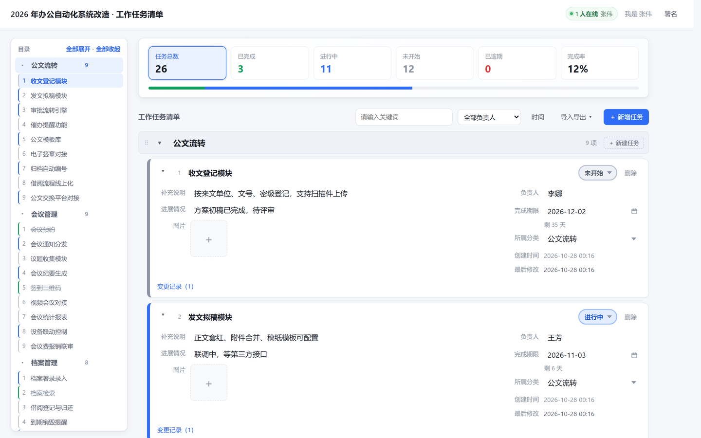

# ReqSlate

**一个单文件后端、零依赖的多人协作任务清单。**

[](https://nodejs.org/)
[]()
[]()

打开浏览器就能用，像表格一样录任务，但每条任务背后有版本号、有逐字段的变更历史、有冲突检测，还能一键导出 Excel、Markdown、JSONL。



日常怎么用、怎么部署，见 [使用手册.md](使用手册.md)。

---

## 特点

- **零依赖**：不用 `npm install`，不用装数据库，不用编译。拷几个文件过去就能跑，x86 / ARM、Windows / Linux 之间可以直接拷。
- **单文件后端**：全部逻辑在一个 `server.js` 里，没有构建步骤，改完刷新浏览器就是最新的。
- **数据是一个文件**：SQLite 单文件，备份就是拷 `data/` 目录。
- **内网友好**：运行期不访问外网，不连 CDN、不检查更新。

## 功能

**任务**

- 就地编辑，失焦即保存：内容、补充说明、进展情况、负责人、完成期限、所属分类都是输入框，不用点「编辑」。
- 状态一个下拉框：未开始 / 进行中 / 已完成，按状态配色。已完成自动锁定（后端强制）。
- 完成期限自带全中文日历，也认 `2026/3/5`、`2026年3月5日`、`20260305` 等写法。
- 每条任务可传图（png/jpg/gif/webp，单张 8MB）。
- 记着**创建时间**和**最后修改时间**，展开后右栏可见（精确到分钟）。今天改过「进展情况」的那一格标红。

**分类**

- 分类可拖动排序；某分类下任务全部完成时自动沉到底部，按完成先后堆叠。
- 序号在分类内部编，增删任务、换分类都自动压实。
- 分类改名撞上已有名字会**合并**，任务接在目标分类末尾。
- 没填分类的任务按新增日期分组成「10月24日新增」，永远钉在最上面，跨天不换组；给这一组改名就变成普通分类。

**看全局**

- 六张统计卡片（总数 / 已完成 / 进行中 / 未开始 / 已逾期 / 完成率），点任一张只看那一类。
- 按负责人筛选，选项从现有任务里自动收集。
- **按时间筛选**：创建时间、最后修改时间各一组起止日期，两端都含；只填一头就是「从这天起」或「截至这天」。
- 左侧目录跟随滚动高亮，可整列收起、可单独收起某个分类。

**协作**

- 顶栏显示当前有几个人在页面上，按人算不按标签页算。
- 别人改了东西 2.5 秒内自动刷新；切回标签页立刻刷一次。
- 两人同时改同一条任务的同一个字段时，后到的收到提示并看到对方刚写的内容，不会互相覆盖；改不同字段互不影响。
- 打字期间自动同步会让路，不会把你打了一半的字冲掉。

**导入导出**

- 导出 Excel（任务清单 + 变更历史两张表，真日期格式、首行冻结、带筛选）、CSV（带 BOM）。
- 导出 Markdown / JSONL，给本地大模型或脚本读。
- 从表格导入，表头中英文都认，日期写法很宽松，CSV 自动识别 GBK。

---

## 快速开始

**Docker**

```bash
# 先改 docker-compose.yml 里的 ADMIN_PASSWORD
docker compose up -d --build
```

打开 `http://服务器IP:3000`。

**直接跑 Node**（需要 Node ≥ 22.5，推荐 24）

```bash
ADMIN_PASSWORD=你的密码 PORT=3000 node server.js
```

Windows 双击 `start.bat`，Linux/macOS 跑 `./start.sh`，两者都会先自检 Node 版本。

### 下载现成的版本

不想自己 clone 的话，去 [Releases](https://github.com/Bu9-maker/ReqSlate/releases) 下载 `ReqSlate-x.y.z.zip`，解压后 `./start.sh` 或 `start.bat` 直接跑，每个版本都附了 sha256。

镜像发布在 `ghcr.io/bu9-maker/reqslate`，同一个标签里同时有 amd64 和 arm64：

```bash
docker run -d --name reqslate -p 3000:3000 \
  -v reqslate-data:/data \
  -e ADMIN_PASSWORD=换成你自己的密码 \
  ghcr.io/bu9-maker/reqslate:1.1.0
```

---

## 目录结构

```
ReqSlate/
├── server.js              # 全部后端逻辑（路由/鉴权/业务/导入导出）
├── xlsx.js                # 自写的 Excel 读写（zip + XML）
├── config.json            # 界面文案
├── README.md              # 本文件
├── 使用手册.md            # 日常用法与部署
├── CHANGELOG.md           # 每个版本改了什么
├── docs/                  # 本文件引用的截图
├── .github/               # 冒烟测试与 CI/Release 工作流
├── public/                # 前端页面、脚本、样式、图标
├── start.bat / start.sh   # 启动脚本
├── Dockerfile / docker-compose.yml
└── data/                  # 运行时生成：board.db + .secret + uploads/
```

要拷到另一台机器：`server.js`、`xlsx.js`、`config.json`、`public/`，有 `data/` 就接着原来的数据用。

---

## 配置

`config.json` 改完刷新浏览器即生效（不用重启）：

```json
{
  "appName": "ReqSlate",
  "overviewTitle": "项目总览",
  "boardTitle": "工作任务清单",
  "titleSeparator": " · ",
  "footerText": "ReqSlate",
  "footerSub": "designed by zhouwh",
  "loginHint": "请输入管理密码"
}
```

环境变量：

| 变量 | 默认 | 说明 |
|---|---|---|
| `PORT` | `3000` | 监听端口 |
| `HOST` | `0.0.0.0` | 监听地址，反代后面设 `127.0.0.1` |
| `DATA_DIR` | `./data` | 数据目录（数据库、密钥、图片） |
| `ADMIN_PASSWORD` | `admin123` | 首页登录密码。**用默认值启动会打警告** |
| `TZ_OFFSET` | `8` | 时区偏移小时数 |

---

## 开发

改完代码想确认没改坏，不用起浏览器：

```bash
ADMIN_PASSWORD=ci-pass PORT=3000 node server.js &
ADMIN_PASSWORD=ci-pass node .github/smoke.mjs
```

冒烟测试用真实 HTTP 请求走一遍登录、建项目、建分类、建任务、改字段、冲突检测、完成锁定、四种导出、导入、在线状态和一批异常输入，75 项断言约 3 秒跑完。推送到 GitHub 后 CI 会自动跑同一份脚本，另外检查语法、`config.json` 合法性、是否引入了第三方依赖，并在 Node 22.5 和 24 上各跑一遍。

发布新版本：在 [CHANGELOG.md](CHANGELOG.md) 加一节 `## [x.y.z] — 日期`，然后 `git tag vx.y.z && git push origin vx.y.z`，Release 工作流会自动跑测试、打 zip、构建 amd64/arm64 镜像推到 ghcr.io、创建 Release。

---

## License

MIT
